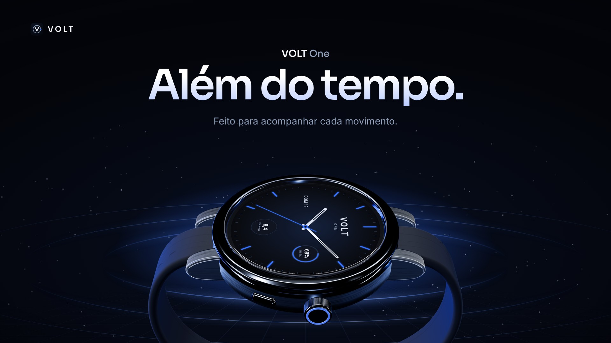
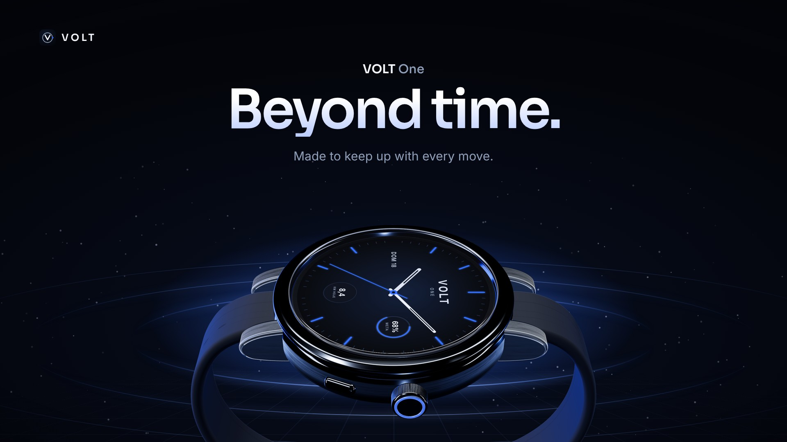

# VOLT One

Landing page conceitual de um smartwatch fictício, com modelo 3D (Three.js) que se desmonta com a rolagem (GSAP ScrollTrigger). PT e EN.

Site estático: abra `index.html` por um servidor local (`python3 -m http.server`). O modelo 3D é procedural, sem arquivos externos.

Projeto de portfólio. Marca, interface e especificações são propostas de design.
